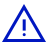

<!-- _class: cover -->
<!-- _paginate: false -->

# Claude CodeのDev Containerで 低減できるリスク

（氏名）

2026年10月4日

---

<!-- header: 結論 ／ 管理策 ／ 有効性 ／ ぜい弱性 ／ リスク対応 -->

# この資料の目的

## Dev Containerが10のリスクをどこまで低減するかを確かめる

<h3>10のリスクはOWASPがまとめたものである1</h3>

<b>OWASP</b>ソフトウェアの安全に 取り組む非営利団体AIエージェントの 10大リスク（2026年版）

ASI01 目標の乗っ取り

ASI02 ツールの悪用

ASI03 身元と権限の悪用

ほか7つ（ASI04〜ASI10）

<h3>Dev Containerは4つの管理策を備える2</h3>

<b>Claude Codeの Dev Container</b>Anthropicが公開する 開発用コンテナの設定例3つの設定ファイルを読む実機では検証していない

通信の許可リスト

非root実行

ファイルの隔離

起動時の検証

---

# まとめ

## 10のリスクは、4つの管理策に追加のリスク対応を重ねれば低減できる

<b>結論</b>

<h3>4つの管理策は6つのリスクを低減するが、起こりやすさは変えない</h3>
リスクと管理策の対応

<b>管理策</b>

<h3>4つの管理策は、ホストとの境界と外部との境界に2つずつ置かれる</h3>
通信の許可リスト非root実行ファイルの隔離

<b>有効性</b>

<h3>境界だけでリスクを低減できるのは6つで、4つは低減できない</h3>
低減できる6つのリスク低減できない4つのリスク公式の警告

<b>ぜい弱性</b>

<h3>持ち出しの経路など10のぜい弱性が、管理策そのものにも残る</h3>
持ち出しの経路

<b>リスク対応</b>

<h3>持ち出しの経路が残っても、構成を変えれば残留リスクは低減できる</h3>

---

<!-- header: '**結論** ／ 管理策 ／ 有効性 ／ ぜい弱性 ／ リスク対応' -->

# 10のリスクと管理策の有効性

## 4つの管理策は6つのリスクを低減するが、起こりやすさは変えない

<h3>低減できないリスクは入力と処理の側に集まる</h3>

入力

処理

出力

利用者の指示

API

外部エージェント

ASI01

ASI03

ASI09

方針と統制

人の確認

エージェント

エージェント

ASI10

ASI07

接続データ

メモリ

ASI06

API・リソース

ツール

ASI02

外部エージェント

ASI04

ASI05

ASI08

<table class="mini">
<tr><td>ASI01</td><td>目標の乗っ取り</td><td class="out">低減できない</td></tr>
<tr><td>ASI02</td><td>ツールの悪用</td><td class="ok">低減できる</td></tr>
<tr><td>ASI03</td><td>身元と権限の悪用</td><td class="ok">低減できる</td></tr>
<tr><td>ASI04</td><td>供給網のぜい弱性</td><td class="ok">低減できる</td></tr>
<tr><td>ASI05</td><td>想定外のコード実行</td><td class="ok">低減できる</td></tr>
<tr><td>ASI06</td><td>記憶と文脈の汚染</td><td class="out">低減できない</td></tr>
<tr><td>ASI07</td><td>安全でない エージェント間通信</td><td class="out">低減できない</td></tr>
<tr><td>ASI08</td><td>連鎖的な障害</td><td class="ok">低減できる</td></tr>
<tr><td>ASI09</td><td>人の信頼の悪用</td><td class="out">低減できない</td></tr>
<tr><td>ASI10</td><td>暴走エージェント</td><td class="ok">低減できる</td></tr>
</table>

---

# リスクと管理策の対応

## 6つのリスクには4つの管理策のどれかが効き、4つには効かない

<h3>管理策が効く6つも、残留リスクが大きい構成では低減しきれない</h3>

<table class="matrix" style="width:1132px">
<tr><th style="width:296px">リスク</th><th style="width:192px">どんなリスクか</th><th class="c" style="width:88px">通信の 許可リスト</th><th class="c" style="width:64px">非root 実行</th><th class="c" style="width:88px">ファイルの 隔離</th><th class="c" style="width:76px">起動時の 検証</th><th style="width:200px">残留リスクが大きい構成</th><th style="width:128px">有効性</th></tr>
<tr><td>ASI01 目標の乗っ取り</td><td>指示で目的が書き換わる</td><td class="c"></td><td class="c"></td><td class="c"></td><td class="c"></td><td>他人の文書を読む</td><td class="out">低減できない</td></tr>
<tr><td>ASI02 ツールの悪用</td><td>ツールが危険に使われる</td><td class="c"></td><td class="c"></td><td class="c"></td><td class="c"></td><td>秘密や大事なデータを置く</td><td class="ok">低減できる</td></tr>
<tr><td>ASI03 身元と権限の悪用</td><td>権限が範囲外で使われる</td><td class="c"></td><td class="c"></td><td class="c"></td><td class="c"></td><td>認証を引き継ぐ</td><td class="ok">低減できる</td></tr>
<tr><td>ASI04 供給網のぜい弱性</td><td>取り込む部品が改ざん済み</td><td class="c"></td><td class="c"></td><td class="c"></td><td class="c"></td><td>外部の部品を取り込む</td><td class="ok">低減できる</td></tr>
<tr><td>ASI05 想定外のコード実行</td><td>意図しない命令が動く</td><td class="c"></td><td class="c"></td><td class="c"></td><td class="c"></td><td>成果物をホストで動かす</td><td class="ok">低減できる</td></tr>
<tr><td>ASI06 記憶と文脈の汚染</td><td>記憶に悪い情報が残る</td><td class="c"></td><td class="c"></td><td class="c"></td><td class="c"></td><td>履歴を引き継ぐ</td><td class="out">低減できない</td></tr>
<tr><td>ASI07 安全でないエージェント間通信</td><td>通信の相手が偽装される</td><td class="c"></td><td class="c"></td><td class="c"></td><td class="c"></td><td>複数を連携させる</td><td class="out">低減できない</td></tr>
<tr><td>ASI08 連鎖的な障害</td><td>1つの誤りが他へ広がる</td><td class="c"></td><td class="c"></td><td class="c"></td><td class="c"></td><td>自動で後工程に流す</td><td class="ok">低減できる</td></tr>
<tr><td>ASI09 人の信頼の悪用</td><td>人が出力を信じすぎる</td><td class="c"></td><td class="c"></td><td class="c"></td><td class="c"></td><td>確かめずに承認する</td><td class="out">低減できない</td></tr>
<tr><td>ASI10 暴走エージェント</td><td>役割から外れて動く</td><td class="c"></td><td class="c"></td><td class="c"></td><td class="c"></td><td>無人で動かす</td><td class="ok">低減できる</td></tr>
</table>

---

<!-- header: '結論 ／ **管理策** ／ 有効性 ／ ぜい弱性 ／ リスク対応' -->

# 4つの管理策の配置

## 4つの管理策は、ホストとの境界と外部との境界に2つずつ置かれる

<h3>管理策は3つの領域の境界で働く</h3>

<b>ホスト</b>

<b>ファイルの隔離</b>作業フォルダだけ見える

<b>非root実行</b>一般ユーザーで動く

<b>コンテナ</b>

<b>通信の許可リスト</b>8種類の宛先だけ通す

<b>起動時の検証</b>遮断を確かめて開始

<b>外部</b>

---

# 通信の許可リスト

## 外部との境界では、通信を許可リストにある宛先だけに絞る

<h3>外向きの通信は既定ですべて遮断される</h3>

<b>コンテナ</b>

許可先 8種類

GitHub

npm

Anthropic API

Sentry

Statsig

VS Code 拡張

VS Code 配布

VS Code 更新

その他の宛先

<h3>遮断は起動時に確かめられる</h3>

<b>起動</b>

確認

example.com に届かない

api.github.com に届く

両方を満たす

<b>開始</b>

どちらか外れる

<b>中止</b>

---

# 非root実行

## 許可リストは、一般ユーザーで動かすので書き換えられない

<h3>実行は一般ユーザーに限られる</h3>

<b>一般ユーザー</b>node

コマンド実行

作業フォルダの編集

許可リストの変更

システム領域の変更

<h3>管理者権限は初期化にしか使えない</h3>

<b>管理者権限</b>sudo

init-firewall.sh

許可リストの設定

遮断の確認

それ以外のコマンド

---

# ファイルの隔離

## 一般ユーザーには、ホストとの境界で作業フォルダだけを見せる

<h3>ホストから渡すのは作業フォルダだけである</h3>

<b>コンテナ</b>

作業フォルダ

SSHの鍵のファイル

クラウドの認証情報

その他のファイル

<h3>鍵は見えないがホストの認証は使える3</h3>

ホストのGit認証とSSHエージェント

VS Code が引き継ぐ

<b>コンテナ</b>

ホストの認証でGitを操作できる

---

<!-- header: '結論 ／ 管理策 ／ **有効性** ／ ぜい弱性 ／ リスク対応' -->

# 有効性の内訳

## 境界だけでリスクを低減できるのは6つで、4つは低減できない

<h3>どのリスクにも残留リスクが大きい構成が1つずつある</h3>

<b>低減できる</b>6つ

<b>ASI02 ツールの悪用</b>秘密や大事なデータを置く

<b>ASI03 身元と権限の悪用</b>認証を引き継ぐ

<b>ASI04 供給網のぜい弱性</b>外部の部品を取り込む

<b>ASI05 想定外のコード実行</b>成果物をホストで動かす

<b>ASI08 連鎖的な障害</b>自動で後工程に流す

<b>ASI10 暴走エージェント</b>無人で動かす

<b>低減できない</b>4つ

<b>ASI01 目標の乗っ取り</b>他人の文書を読む

<b>ASI06 記憶と文脈の汚染</b>履歴を引き継ぐ

<b>ASI07 安全でないエージェント間通信</b>複数を連携させる

<b>ASI09 人の信頼の悪用</b>確かめずに承認する

---

# 低減できる6つのリスク

## 低減できる6つも、コンテナの中にあるものは守れない

<h3>6つのうち2つは、VS Codeでそのまま使うと当てはまる</h3>

<table class="big same" style="table-layout:fixed;width:1068px">
<tr><th style="width:380px">リスク</th><th style="width:276px">管理策の働き</th><th style="width:262px">残留リスクが大きい構成</th><th style="width:150px">そのまま使うと</th></tr>
<tr><td>ASI02 ツールの悪用</td><td>ホストと許可外には届かない</td><td>秘密や大事なデータを置く</td><td>当てはまらない</td></tr>
<tr><td>ASI03 身元と権限の悪用</td><td>鍵のファイルは見えない</td><td>認証を引き継ぐ</td><td>当てはまる</td></tr>
<tr><td>ASI04 供給網のぜい弱性</td><td>通信先は許可先だけ</td><td>外部の部品を取り込む</td><td>当てはまる</td></tr>
<tr><td>ASI05 想定外のコード実行</td><td>実行はコンテナ内に留まる</td><td>成果物をホストで動かす</td><td>当てはまらない</td></tr>
<tr><td>ASI08 連鎖的な障害</td><td>コンテナ内に留まる</td><td>自動で後工程に流す</td><td>当てはまらない</td></tr>
<tr><td>ASI10 暴走エージェント</td><td>行動範囲を封じ込める</td><td>無人で動かす</td><td>当てはまらない</td></tr>
</table>

---

# 低減できない4つのリスク

## コンテナで囲っても、判断と過信に関わる4つは低減できない

<h3>4つとも隔離では止められず、1つだけが当てはまらない</h3>

<table class="big same" style="table-layout:fixed;width:1068px">
<tr><th style="width:380px">リスク</th><th style="width:276px">管理策の働き</th><th style="width:262px">残留リスクが大きい構成</th><th style="width:150px">そのまま使うと</th></tr>
<tr><td>ASI01 目標の乗っ取り</td><td>読む内容を検査しない</td><td>他人の文書を読む</td><td>当てはまる</td></tr>
<tr><td>ASI06 記憶と文脈の汚染</td><td>保存内容を検査しない</td><td>履歴を引き継ぐ</td><td>当てはまる</td></tr>
<tr><td>ASI07 安全でないエージェント間通信</td><td>通信を守る仕組みがない</td><td>複数を連携させる</td><td>当てはまらない</td></tr>
<tr><td>ASI09 人の信頼の悪用</td><td>人の判断に関与しない</td><td>確かめずに承認する</td><td>当てはまる</td></tr>
</table>

---

# 公式の警告

## 過信せず認証情報の持ち出しに備えるよう、公式も警告している

<h3>許可確認を省くと持ち出しは防げない4</h3>

悪意あるプロジェクト

許可確認なしで実行

<b>コンテナ</b>Claude Code の認証情報がある

持ち出し

外部

<h3>公式は使い方に3つの条件を付けている</h3>

信頼できるリポジトリで使う

Claude の動作を監視する

ホストの秘密を持ち込まない

---

<!-- header: '結論 ／ 管理策 ／ 有効性 ／ **ぜい弱性** ／ リスク対応' -->

# 管理策に残る10のぜい弱性

## 持ち出しの経路など10のぜい弱性が、管理策そのものにも残る

<h3>ぜい弱性は持ち出し、設定、波及、監視の4種類に分かれる</h3>

<b>持ち出しの経路</b>4つ

DNSの宛先が無制限

SSHの宛先が無制限

許可先への送信

ホスト側ネットワーク

<b>設定</b>3つ

許可IPが起動時に固定

IPv6の規則がない

版が固定されていない

<b>ホスト側への波及</b>2つ

作業フォルダ経由の実行

ホストの認証の引き継ぎ

<b>監視</b>1つ

監視と記録がない

---

# 持ち出しの経路

## ぜい弱性のうち持ち出しは、許可リストの例外と許可先そのものを通る

<h3>3つの例外は許可リストを通らない</h3>

<b>コンテナ</b>

DNS（宛先を問わない）

SSH（宛先を問わない）

ホスト側ネットワーク

<h3>許可先へは攻撃者の認証情報で送れる</h3>

<b>コンテナ</b>

攻撃者が用意した認証情報

許可先（GitHub、npm）

攻撃者のアカウント

---

<!-- header: '結論 ／ 管理策 ／ 有効性 ／ ぜい弱性 ／ **リスク対応**' -->

# 残留リスクへの対応

## 持ち出しの経路が残っても、構成を変えれば残留リスクは低減できる

<h3>どのリスクにも、残留リスクを低減する対応が1つずつある</h3>

<table class="avoid" style="table-layout:fixed;width:1040px">
<tr><th style="width:340px">リスク</th><th style="width:300px">残留リスクが大きい構成</th><th style="width:400px">リスク対応</th></tr>
<tr><td>ASI01 目標の乗っ取り</td><td>他人の文書を読む</td><td>信頼できるリポジトリで使う</td></tr>
<tr><td>ASI02 ツールの悪用</td><td>秘密や大事なデータを置く</td><td>秘密は絞り、データは控えを取る</td></tr>
<tr><td>ASI03 身元と権限の悪用</td><td>認証を引き継ぐ</td><td>権限と期限を絞った認証だけ渡す</td></tr>
<tr><td>ASI04 供給網のぜい弱性</td><td>外部の部品を取り込む</td><td>確かめた部品だけ取り込む</td></tr>
<tr><td>ASI05 想定外のコード実行</td><td>成果物をホストで動かす</td><td>成果物はコンテナの中で動かす</td></tr>
<tr><td>ASI06 記憶と文脈の汚染</td><td>履歴を引き継ぐ</td><td>履歴を持ち越さない</td></tr>
<tr><td>ASI07 安全でないエージェント間通信</td><td>複数を連携させる</td><td>連携させない</td></tr>
<tr><td>ASI08 連鎖的な障害</td><td>自動で後工程に流す</td><td>後工程に流す前に確かめる</td></tr>
<tr><td>ASI09 人の信頼の悪用</td><td>確かめずに承認する</td><td>確かめてから承認する</td></tr>
<tr><td>ASI10 暴走エージェント</td><td>無人で動かす</td><td>人が見ている間だけ動かす</td></tr>
</table>

---

<!-- header: '結論 ／ 管理策 ／ 有効性 ／ ぜい弱性 ／ リスク対応' -->

# まとめ

## 10のリスクは、4つの管理策に追加のリスク対応を重ねれば低減できる

<b>結論</b>

<h3>4つの管理策は6つのリスクを低減するが、起こりやすさは変えない</h3>

<b>管理策</b>

<h3>4つの管理策は、ホストとの境界と外部との境界に2つずつ置かれる</h3>

<b>有効性</b>

<h3>境界だけでリスクを低減できるのは6つで、4つは低減できない</h3>

<b>ぜい弱性</b>

<h3>持ち出しの経路など10のぜい弱性が、管理策そのものにも残る</h3>

<b>リスク対応</b>

<h3>持ち出しの経路が残っても、構成を変えれば残留リスクは低減できる</h3>

---

<!-- _class: source -->
<!-- header: '' -->

# 参考文献

<table class="big refs">
<tr><td>1.</td><td>OWASP Gen AI Security Project - Agentic Security Initiative, "OWASP Top 10 for Agentic Applications for 2026" (2025); <a href="https://genai.owasp.org/resource/owasp-top-10-for-agentic-applications-for-2026/">genai.owasp.org/resource/owasp-top-10-for-agentic-applications-for-2026/</a> 10のリスクの図は、この文献の「Agentic Top 10 At A Glance」をもとに作成（CC BY-SA 4.0）</td></tr>
<tr><td>2.</td><td>Anthropic, claude-code: .devcontainer, commit 1c229fc (2026); <a href="https://github.com/anthropics/claude-code/tree/main/.devcontainer">github.com/anthropics/claude-code/tree/main/.devcontainer</a></td></tr>
<tr><td>3.</td><td>Microsoft, Sharing Git credentials with your container, Visual Studio Code Docs (2026); <a href="https://code.visualstudio.com/remote/advancedcontainers/sharing-git-credentials">code.visualstudio.com/remote/advancedcontainers/sharing-git-credentials</a></td></tr>
<tr><td>4.</td><td>Anthropic, Development containers, Claude Code Docs (2026); <a href="https://code.claude.com/docs/en/devcontainer">code.claude.com/docs/en/devcontainer</a></td></tr>
</table>

